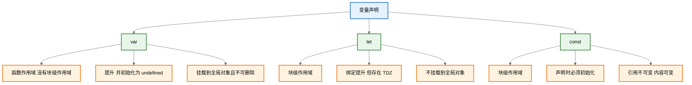
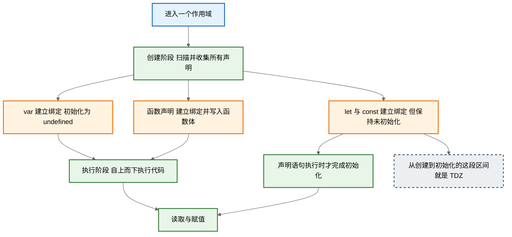

# 变量声明

|        区别        | `var` | `let` | `const` |
| :----------------: | :---: | :---: | :-----: |
|  是否有块级作用域  |   ×   |  ✔️   |   ✔️    |
|  是否存在变量提升  |  ✔️   |   ×   |    ×    |
|  是否添加全局属性  |  ✔️   |   ×   |    ×    |
|  能否重复声明变量  |  ✔️   |   ×   |    ×    |
| 是否存在暂时性死区 |   ×   |  ✔️   |   ✔️    |
| 是否必须设置初始值 |   ×   |   ×   |   ✔️    |
|  能否改变指针指向  |  ✔️   |  ✔️   |    ×    |

ECMAScript 变量是松散类型的，意思是变量可以用于保存任何类型的数据。每个变量只不过是一个用于保存任意值的命名占位符。有 3 个关键字可以声明变量：`var`、`const` 和 `let`。

## 知识地图



## 1. `var` 关键字

要定义变量，可以使用 `var` 操作符（注意 `var` 是一个关键字）后跟变量名（即标识符，如前所述）：

```javascript
var message
```

这行代码定义了一个名为 `message` 的变量，可以用它保存任何类型的值。（不初始化的情况下，变量会保存一个特殊值 `undefined`）。因为 ECMAScript 实现了变量初始化，因此可以同时定义变量并设置它的值：<span style="color: #e74c3c;">【修正】原内容有误，原句缺少关联词且时态不完整，已改为：因为 ECMAScript 实现了变量初始化，因此可以同时定义变量并设置它的值</span>

```javascript
var message = 'hi'
```

这里，`message` 被定义为一个保存字符串值 `'hi'` 的变量。像这样初始化变量不会将它标识为字符串类型，只是一个简单的赋值而已。随后，不仅可以改变保存的值，也可以改变值的类型：

```javascript
var message = 'hi'
message = 100 // 合法，但不推荐
```

在这个例子中，变量 `message` 首先被定义为一个保存字符串值 `'hi'` 的变量，然后又被重写为保存了数值 `100`。虽然不推荐改变变量保存值的类型，但这在 ECMAScript 中是完全有效的。

### 1.1 `var` 声明作用域

在全局作用域中，`var` 声明的变量被挂到 `window`。

使用 `var` 操作符定义的变量会成为包含它的函数的局部变量，意味着该变量将在函数退出时被销毁：

```javascript
function test() {
  var message = 'hi' // 局部变量
}
test()
console.log(message) // 出错！
```

`message` 变量是在函数内部使用 `var` 定义的，函数叫 `test()`，调用它会创建这个变量并给它赋值。调用之后变量随即被销毁，因此示例中的最后一行会导致错误。不过，在函数内定义变量时省略 `var` 操作符，可以创建一个全局变量：

```javascript
function test() {
  message = 'hi' // 全局变量
}
test()
console.log(message) // 'hi'
```

去掉之前的 `var` 操作符之后，`message` 就变成了全局变量。只要调用一次函数 `test()`，就会定义这个变量，并且可以在函数外部访问到。

:::warning 注意
虽然可以通过省略 `var` 操作符定义全局变量，但不推荐这么做。在局部作用域中定义的全局变量很难维护，也会造成困惑。这是因为不能一下子断定省略 `var` 是不是有意而为之。在严格模式下，如果像这样给未声明的变量赋值，则会导致抛出 `ReferenceError`。
:::

`var` 只有函数作用域，没有块级作用域，`if`、`for`、`switch` 这类花括号不会限制它的活动范围：

```javascript
if (true) {
  var name = 'LBJhui'
}
console.log(name) // 'LBJhui'，变量泄漏到了块外

for (var i = 0; i < 3; i++) {}
console.log(i) // 3，循环结束后依然存在
```

这正是 ES5 时代要把所有变量声明集中写在函数顶部的直接原因：既然放在哪里都一样，不如统一放在顶部方便查看。

另外，全局 `var` 创建的属性是不可配置的，用 `delete` 无法删除：

```javascript
var a = 1
console.log(window.a) // 1
delete window.a // false
```

### 1.2 `var` 声明提升

使用 `var` 时，下面的代码不会报错。这是因为使用这个关键字声明的变量会自动提升到函数作用域顶部：

```javascript
function foo() {
  console.log(age)
  var age = 26
}
foo() // undefined
```

之所以不会报错，是因为 ECMAScript 运行时把它看成等价于如下代码：

```javascript
function foo() {
  var age
  console.log(age)
  age = 26
}
foo() // undefined
```

这就是所谓的 “提升”（Hoist），也就是把所有变量声明都拉到函数作用域的顶部。此外，反复多次使用 `var` 声明同一个变量也没有问题。

```javascript
var count = 1
var count = 2
console.log(count) // 2，后一次声明覆盖前一次
```

需要强调的是，提升的只是 “声明” 本身，赋值仍留在原来的位置，因此 `var` 变量在初始化之前访问不会报错，只会得到 `undefined`。

### 1.3 函数声明与 `var` 的提升差异

`var` 提升的是变量的声明，函数声明则是 “整体提升”，函数名和函数体一起被提到作用域顶部：

```javascript
console.log(typeof foo) // 'function'，函数体已整体提升
var foo = 'bar'
function foo() {}

console.log(typeof foo) // 'string'，赋值覆盖了函数
```

同一个作用域里，函数声明的提升优先级高于 `var`，同名时函数先占住这个名字，后续赋值再把它覆盖掉。

而函数表达式走的是 `var` 规则，只有变量名被提升，函数体并没有被提升，提前调用就会报错：

```javascript
sayHi() // TypeError: sayHi is not a function
var sayHi = function () {
  console.log('hi')
}
```

在严格模式和 ES 模块中，块内声明的函数只在块内可见：

```javascript
'use strict'
{
  function fn() {}
}
fn() // ReferenceError: fn is not defined
```

在非严格脚本里，引擎为了兼容旧代码会把它泄漏到外层函数作用域，这属于 Annex B 的补充语义，不建议依赖。

## 2. `let` 声明

`let` 跟 `var` 的作用差不多，但有着非常重要的区别。最明显的区别是，`let` 声明的范围是块作用域，而 `var` 声明的范围是函数作用域。

```javascript
if (true) {
  var name = 'LBJhui'
  console.log(name) // 'LBJhui'
}
console.log(name) // 'LBJhui'

if (true) {
  let name = 'LBJhui'
  console.log(name) // 'LBJhui'
}
console.log(name) // ReferenceError: name 没有定义
```

块作用域是函数作用域的子集，因此适用于 `var` 的作用域限制同样也适用于 `let`。

`let` 也不允许同一个块作用域中出现冗余声明。这样会导致报错：

```javascript
let age
let age // SyntaxError；标识符 age 已经声明过了
```

当然，JavaScript 引擎会记录用于变量声明的标识符及其所在的块作用域，因此嵌套使用相同的标识符不会报错，而这是因为同一个块中没有重复声明。

### 2.1 暂时性死区

`let` 与 `var` 的另一个重要的区别，就是 `let` 声明的变量不会在作用域中被提升。

```javascript
// name 会被提升
console.log(name) // undefined
var name = 'LBJhui'

// name 不会被提升
console.log(name) // ReferenceError：name 没有定义
let name = 'LBJhui'
```

在解析代码时，JavaScript 引擎也会注意出现在块后面的 `let` 声明，只不过在此之前不能以任何方式来引用未声明的变量。在 `let` 声明之前的执行瞬间被称为 “暂时性死区”（Temporal Dead Zone），在此阶段引用任何后面才声明的变量都会抛出 `ReferenceError`。在 `let` 声明的作用域外对该变量使用 `typeof` 则不会报错，具体示例如下：

```javascript
console.log(typeof value) // undefined

{
  let value = true
}
```

上面这段示例返回 `'undefined'`，是因为 `let value` 位于**内层块**，对 `typeof value` 这行代码根本不可见，并不代表 TDZ 对 `typeof` 是安全的。两者处于同一作用域时，`typeof` 一样会抛错：

```javascript
// 情况一：变量从未声明，typeof 返回字符串 'undefined'
console.log(typeof notDeclared) // 'undefined'

// 情况二：本作用域后方存在 let 声明，变量正处于 TDZ
console.log(typeof later) // ReferenceError: Cannot access 'later' before initialization
let later
```

原因在于 `typeof` 也必须先读取这个绑定，而检查绑定时就已经撞上了死区。所以 “能用 `typeof` 判断变量是否存在” 这条老经验，在 `let` 上并不成立。

TDZ 的终点是 `let` 语句执行的那一刻，因此初始化表达式引用自己同样会失败：

```javascript
let self = self // ReferenceError: Cannot access 'self' before initialization
```

此外，同一个作用域里不允许 `let` 与 `var` 声明同名，这个问题在解析阶段就会暴露：

```javascript
var duplicate = 1
let duplicate = 2 // SyntaxError: Identifier 'duplicate' has already been declared
```

### 2.2 全局声明

与 `var` 关键字不同，使用 `let` 在全局作用域中声明的变量不会成为 `window` 对象的属性（`var` 声明的变量则会）。

```javascript
var name = 'LBJhui'
console.log(window.name) // 'LBJhui'

let name = 'LBJhui'
console.log(window.name) // undefined
```

不过，`let` 声明仍然是在全局作用域中发生的，相应变量会在页面的生命周期内存续。因此，为了避免 `SyntaxError`，必须确保页面不会重复声明同一个变量。

从规范层面看，顶层的 `let` / `const` 落在 “全局词法环境（Global Lexical Environment）” 中，而 `var` 和函数声明落在 “全局对象环境” 中。前者对代码可见，但不会映射到 `window` 上：

```javascript
let a = 1
console.log(window.a) // undefined
console.log(globalThis.a) // undefined
```

这也解释了一个常见现象：页面里两个独立的脚本文件各写一次 `let a = 1`，即使逻辑上毫无关系，仍会抛出 `SyntaxError`，因为它们的词法绑定落在同一个全局词法环境里。

### 2.3 `for` 循环中的 `let` 声明

`for` 循环的计数器，就很合适使用 `let` 命令。

```javascript
for (let i = 0; i < 10; i++) {
  // ...
}
console.log(i) // ReferenceError: i is not defined
```

上面代码中，计数器 `i` 只在 `for` 循环体内有效，在循环体外引用就会报错。

下面的代码如果使用 `var`，最后输出的是 `10`。

```javascript
var a = []
for (var i = 0; i < 10; i++) {
  a[i] = function () {
    console.log(i)
  }
}
a[6]() // 10
```

上面代码中，变量 `i` 是 `var` 命令声明的，在全局范围内都有效，所以全局只有一个变量 `i`。每一次循环，变量 `i` 的值都会发生改变，而循环内被赋给数组 `a` 的函数内部的 `console.log(i)`，里面的 `i` 指向的就是全局的 `i`。也就是说，所有数组 `a` 的成员里面的 `i`，指向的都是同一个 `i`，导致运行时输出的是最后一轮的 `i` 的值，也就是 `10`。

如果使用 `let`，声明的变量仅在块级作用域内有效，最后输出的是 `6`。

```javascript
var a = []
for (let i = 0; i < 10; i++) {
  a[i] = function () {
    console.log(i)
  }
}
a[6]() // 6
```

上面代码中，变量 `i` 是 `let` 声明的，当前的 `i` 只在本轮循环有效，所以每一次循环的 `i` 其实都是一个新的变量，所以最后输出的是 `6`。你可能会问，如果每一轮循环的变量 `i` 都是重新声明的，那它怎么知道上一轮循环的值，从而计算出本轮循环的值？这是因为 JavaScript 引擎内部会记住上一轮循环的值，初始化本轮的变量 `i` 时，就在上一轮循环的基础上进行计算。

另外，`for` 循环还有一个特别之处，就是设置循环变量的那部分是一个父作用域，而循环体内部是一个单独的子作用域。

```javascript
for (let i = 0; i < 3; i++) {
  let i = 'abc'
  console.log(i) // abc abc abc
}
```

上面代码正确运行，输出了 3 次 `abc`。这表明循环体内部的变量 `i` 与循环变量 `i` 不在同一个作用域，有各自单独的作用域。<span style="color: #e74c3c;">【修正】原内容有误，上例并未处于函数中，“函数内部的变量 i” 已改为 “循环体内部的变量 i”；同时删除了本段末尾与本节开头重复的句子（“for 循环的计数器，就很合适使用 let 命令。”）</span>

:::details 面试题

**如果希望循环中输出 `012`，有哪些方式可以改**

```javascript
for (var i = 0; i < 3; i++) {
  setTimeout(() => {
    console.log(new Date(), i)
  }, 1000)
}
console.log(new Date(), i)
```

1. 使用 `let`（推荐）

```javascript
for (let i = 0; i < 3; i++) {
  setTimeout(() => {
    console.log(new Date(), i)
  }, 1000)
}
console.log(new Date(), i) // ReferenceError: i is not defined（因为 let 是块级作用域）
```

每次循环都会创建一个新的 `i`（块级作用域），每个 `setTimeout` 回调捕获的是各自循环中的 `i` 值。

> 注意：最后一行 `console.log(i)` 会报错，因为 `i` 在 `for` 外不可见。如果需要，可在外层再定义一个变量。

2. 使用 `IIFE`（立即执行函数表达式）

```javascript
for (var i = 0; i < 3; i++) {
  ;(function (j) {
    setTimeout(() => {
      console.log(new Date(), j)
    }, 1000)
  })(i)
}
console.log(new Date(), i) // 输出 3
```

把当前的 `i` 作为参数传入 `IIFE`，形成新的作用域，`j` 就是当时的值。

3. 利用 `setTimeout` 的第三个参数（传递参数）

```javascript
for (var i = 0; i < 3; i++) {
  setTimeout(
    (j) => {
      console.log(new Date(), j)
    },
    1000,
    i
  ) // 第三个参数会作为回调函数的参数传入
}
console.log(new Date(), i) // 输出 3
```

简洁、兼容性好（IE 10+ 支持）。

4. 用 `.bind()` 绑定参数

```javascript
for (var i = 0; i < 3; i++) {
  setTimeout(
    function (j) {
      console.log(new Date(), j)
    }.bind(null, i),
    1000
  )
}
console.log(new Date(), i) // 输出 3
```

`.bind(null, i)` 会把 `i` 作为第一个参数传给函数。

5. 用数组方法替代 `for` 循环（更函数式）

```js
;[0, 1, 2].forEach((i) => {
  setTimeout(() => {
    console.log(new Date(), i)
  }, 1000)
})
// 注意：这里没有外部的 i，所以不需要担心作用域
```

:::

### 2.4 块作用域的常见场景

块级作用域不止 `if` 和 `for`，凡是 `{}` 围起来的区域都算数：`switch` 的 `case`、`try...catch` 的 `catch` 块，甚至单独一段 `{}`。

`switch` 的各个 `case` 共用同一个块，两个 `case` 里各声明一次同名变量会直接报错，需要用 `{}` 分别包出独立块：

```javascript
const type = 'a'
switch (type) {
  case 'a': {
    let msg = 'A'
    console.log(msg) // 'A'
    break
  }
  case 'b': {
    let msg = 'B'
    console.log(msg)
    break
  }
}
```

如果不加这对花括号，第二个 `case` 里的 `let msg` 就会因为 “同一块内重复声明” 抛 `SyntaxError`。

`catch` 的参数同样只在 `catch` 块内有效：

```javascript
try {
  throw new Error('boom')
} catch (err) {
  console.log(err.message) // 'boom'
}
console.log(typeof err) // 'undefined'
```

内层块声明同名变量会遮蔽（shadowing）外层变量，两个 `name` 互不干扰：

```javascript
let name = 'outer'
{
  let name = 'inner'
  console.log(name) // 'inner'
}
console.log(name) // 'outer'
```

遮蔽本身是合法的，但它会让阅读时难以判断当前引用的是哪一个变量，嵌套层数一多尤其危险，工程上通常用 ESLint 的 `no-shadow` 规则限制。

## 3. `const` 声明

`const` 的行为与 `let` 基本相同，唯一一个重要的区别是用它声明变量时必须同时初始化变量，且尝试修改 `const` 声明的变量会导致运行时错误。

```javascript
const age = 26
age = 36 // TypeError: 给常量赋值

// const 也不允许重复声明
const name = 'LBJhui'
const name = 'Wade' // SyntaxError

// const 声明的作用域也是块
const name = 'LBJhui'
if (true) {
  const name = 'Wade'
}
console.log(name) // LBJhui
```

`const` 声明的限制只适用于它指向的变量的引用。`const` 声明不允许修改绑定，但允许修改值。换句话说，如果 `const` 变量引用的是一个对象，那么修改这个对象内部的属性并不违反 `const` 的限制。

```javascript
const person = {}
person.name = 'LBJhui' // ok
```

JavaScript 引擎会为 `for` 循环中的 `let` 声明分别创建独立的变量实例，虽然 `const` 变量跟 `let` 变量很相似，但是不能用 `const` 来声明迭代变量（因为迭代变量会自增）：<span style="color: #e74c3c;">【修正】此处原为半角冒号，已改为中文全角冒号</span>

```javascript
for (const i = 0; i < 10; ++i) {} // TypeError：给常量赋值
```

不过，如果你只想用 `const` 声明一个不会被修改的 `for` 循环变量，那也是可以的。也就是说，每次迭代只是创建一个新变量。这对 `for-of` 和 `for-in` 循环特别有意义：

```javascript
let i = 0
for (const j = 7; i < 5; ++i) {
  console.log(j) // 7, 7, 7, 7, 7
}

for (const key in { a: 1, b: 2 }) {
  console.log(key) // a, b
}

for (const value of [1, 2, 3, 4, 5]) {
  console.log(value) // 1, 2, 3, 4, 5
}
```

`for-of` 和 `for-in` 之所以可以用 `const`，是因为这两个循环的每一轮都由引擎重新创建一个绑定并完成初始化，循环体内并不需要再给它赋值。

### 3.1 `const` 与引用类型

`const` 锁定的是变量的引用（即栈中的指针），而非堆中的值。因此对于数组、`Set`、`Map` 等可变数据结构同样适用：

```javascript
const arr = [1, 2, 3]
arr.push(4) // ✅ 允许 — 修改堆中的值，引用未变
arr[0] = 0 // ✅ 允许
arr = [5, 6, 7] // ❌ TypeError — 尝试修改引用本身

const set = new Set([1, 2])
set.add(3) // ✅ 允许
set = new Set() // ❌ TypeError
```

### 3.2 如何冻结对象

如果确实需要让对象属性也无法被修改，可以使用 `Object.freeze()`：

```javascript
const obj = Object.freeze({ name: 'LBJhui' })
obj.name = 'Wade' // ❌ 静默失败（严格模式下 TypeError）
obj.age = 26 // ❌ 同样失败
```

不过 `Object.freeze()` 是**浅冻结**，它只锁住对象自身的第一层属性，嵌套对象依然可以被修改：

```javascript
const shallow = Object.freeze({
  theme: 'dark',
  nested: { level: 1 }
})

shallow.theme = 'light' // ❌ 修改失败
shallow.nested.level = 2 // ✅ 依然生效，嵌套对象没有被冻结

console.log(Object.isFrozen(shallow)) // true
console.log(Object.isFrozen(shallow.nested)) // false
```

要真正不可变，需要递归冻结每一层：

```javascript
function deepFreeze(obj, visited = new WeakSet()) {
  if (obj === null || typeof obj !== 'object') return obj
  if (visited.has(obj)) return obj // 遇到循环引用直接返回，避免无限递归
  visited.add(obj)
  Object.values(obj).forEach((value) => deepFreeze(value, visited))
  return Object.freeze(obj)
}

const config = deepFreeze({ theme: 'dark', nested: { level: 1 } })
config.nested.level = 2 // ❌ 静默失败（严格模式下 TypeError）
console.log(Object.isFrozen(config.nested)) // true
```

补充两点区别：`Object.freeze()` 让属性既不可增删也不可改值，`Object.seal()` 只禁止增删、仍允许改值；状态分别用 `Object.isFrozen()` 和 `Object.isSealed()` 检测。

### 3.3 三个常见误区

**误区一：`const` 声明的变量不可变。** 准确的说法是 “绑定不可重新赋值”，对象内部的属性照样能改。真要不可变，得配合 `Object.freeze()` 使用。

**误区二：`const` 没有暂时性死区。** `const` 与 `let` 一样存在 TDZ，声明前访问同样会抛错：

```javascript
console.log(MAX) // ReferenceError: Cannot access 'MAX' before initialization
const MAX = 100
```

**误区三：`const` 比 `let` 性能更好。** 现代引擎对两者的实现几乎没有差别，选择 `const` 的理由是可读性与意图表达，而不是运行时开销。

## 4. 声明提升与暂时性死区的机制

前面反复提到 “提升” 和 “死区”，把它们放到一条时间线上更容易理解。JavaScript 进入一个作用域时，会先做一次 “创建”，再逐行 “执行”：



### 4.1 两个阶段对照表

| 环节       | `var`                         | `let`                     | `const`                      |
| ---------- | ----------------------------- | ------------------------- | ---------------------------- |
| 创建阶段   | 建立绑定并初始化为 `undefined` | 建立绑定但不初始化（TDZ） | 建立绑定但不初始化（TDZ）    |
| 执行阶段   | 声明处只是赋值                | 声明语句执行时完成初始化  | 声明语句执行时必须同时初始化 |
| 声明前访问 | 得到 `undefined`              | 抛 `ReferenceError`       | 抛 `ReferenceError`          |
| 重复声明   | 允许，后者覆盖                | `SyntaxError`             | `SyntaxError`                |

### 4.2 精确表述

`let` / `const` 的绑定其实**也会被提前创建**，只是保持未初始化状态，这种 “已创建但不可访问” 的状态就是 TDZ。所以表格里 “不存在变量提升” 的准确含义是 “不能提前访问”，而不是 “声明不存在”。

理解这一点之后，三类现象就能串起来：

- `var` 有提升且带默认值，所以声明前访问得到 `undefined`，错误被悄悄藏了起来；
- `let` / `const` 有绑定但无值，所以声明前访问直接抛错，问题在编码阶段就暴露；
- 函数声明属于 “整体提升”，所以能提前调用；函数表达式只是普通 `var`，提前调用得到 `TypeError`。

<span style="color: #3498db;">【补充】增加了 “创建阶段 / 执行阶段” 的机制说明，用于精确解释表格中 let、const “不存在变量提升” 的真实含义。</span>

## 5. 常见陷阱清单

- **循环里的 `var` 与闭包**：见 2.3 节，`var` 让所有回调共享同一个 `i`，只有块级声明才能为每轮迭代保留独立变量。
- **用 `typeof` 检测 `let` 变量**：对处于 TDZ 的变量会抛 `ReferenceError`，应提前声明，或用 `try...catch` 包裹后再判断。
- **`switch` 的 `case` 里直接声明同名 `let`**：多个 `case` 共用一个块，必须用 `{}` 分别包出独立块。
- **顶层重复声明**：顶层 `let` 落在全局词法环境，两个脚本文件里的同名声明同样会冲突。
- **在 `if` 块里写 `var`**：`var` 没有块级作用域，变量必然泄漏到函数或全局，容易造成误判。
- **`const` 声明对象后以为内容不可变**：它只保证引用不被改写，内容不可变要额外 `Object.freeze()`。
- **跨块调用块内函数声明**：严格模式和 ES 模块中，块内函数只在本块可见。

## 6. 与其他声明形式的关系

JavaScript 的声明不止 `var`、`let`、`const` 三种，函数声明、类声明、导入声明同样有各自的作用域与提升规则：

| 声明形式            | 作用域               | 提升行为                   | 可否重复声明              |
| ------------------- | -------------------- | -------------------------- | ------------------------- |
| `var`               | 函数 / 全局          | 提升并初始化为 `undefined` | 允许                      |
| `let` / `const`     | 块                   | 提升但不初始化（TDZ）      | 不允许                    |
| 函数声明 `function` | 函数 / 块（严格模式） | 整体提升，可在声明前调用   | 同一作用域允许，后者覆盖   |
| 类声明 `class`      | 块                   | 提升但不初始化（TDZ）      | 不允许                    |
| 导入声明 `import`   | 模块顶层             | 绑定提升，声明前即可引用   | 不允许                    |

类声明和 `let` 一样存在 TDZ，因此在声明前实例化会直接报错：

```javascript
new Person() // ReferenceError: Cannot access 'Person' before initialization
class Person {}
```

`import` 的绑定虽然被提升，但被导入的模块必须先完成求值才能真正取值。循环依赖时，`var` 导出的变量可能拿到 `undefined`，`let` 导出的变量则可能触发 TDZ 报错。

跨环境访问全局对象现在有统一入口 `globalThis`，浏览器中它就是 `window`：

```javascript
console.log(globalThis === window) // 浏览器中为 true
```

另外，ES 模块的顶层是模块作用域，模块里的 `var` 不会挂到 `window`：

```javascript
// module.js
var a = 1
console.log(window.a) // undefined
```

所以 “`var` 一定污染全局” 只说对了一半：真正污染全局的是普通脚本（classic script）顶层声明的 `var`，模块作用域则是隔离的。

## 7. 工程实践与 ESLint 规范

变量声明的风格通常交给 ESLint 约束，与本文主题直接相关的规则有这几条：

```json
{
  "no-var": "error",
  "prefer-const": "error",
  "block-scoped-var": "error",
  "no-shadow": "warn",
  "one-var": ["warn", "never"]
}
```

- `no-var`：禁止使用 `var`，变量声明只允许 `let` / `const`。
- `prefer-const`：声明后从未重新赋值，就必须用 `const`。
- `block-scoped-var`：把 `var` 强制约束在声明所在的块内。
- `no-shadow`：禁止内层变量遮蔽外层同名变量。
- `one-var`：限制一个声明语句里塞进多个变量。

命名也有通行约定：

| 类型        | 命名风格           | 示例              |
| ----------- | ------------------ | ----------------- |
| 普通变量    | `camelCase`        | `userName`        |
| 常量 / 配置 | `UPPER_SNAKE_CASE` | `MAX_RETRY_COUNT` |
| 私有 / 内部 | 前导下划线         | `_cache`          |
| 布尔量      | 前缀 `is` / `has`  | `isVisible`       |

另外两点实践建议：

1. 声明遵循 “就近原则”，在使用处附近声明，而不是像 `var` 时代那样统一堆在函数顶部。
2. 块级声明让变量在块结束后就不再可达，引擎因此有条件更早回收；循环体里处理大对象时优先用块级声明，避免被 `var` 拖到函数结束才释放。

## 8. 最佳实践总结

> **默认使用 `const`，需要重新赋值时用 `let`，永远不要用 `var`。**

| 场景                     | 推荐声明方式                     |
| ------------------------ | -------------------------------- |
| 不会重新赋值的变量       | `const`                          |
| 循环计数器 / 累加器      | `let`                            |
| 需要在块外访问（不推荐） | 抽出外层变量用 `let`             |
| `for-of` / `for-in` 迭代 | 优先 `const`（每次迭代重新创建） |
| 需要不可变的配置对象     | `const` + `Object.freeze()`      |

这样做的理由：

- `const` 能清晰地传达 “这个变量不会被重新赋值” 的意图，降低代码阅读时的认知负担。
- 避免 `var` 的变量提升、全局属性污染、块作用域缺失等历史问题。
- 块级声明的生命周期更短、可见范围更小，排查问题时更容易定位来源。
- 在团队协作和代码审查中提供统一的风格约束。

记忆口诀：**能用 `const` 就别用 `let`，能用 `let` 就别用 `var`；能写在块里，就别写在函数顶。**
