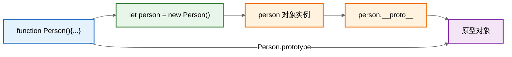
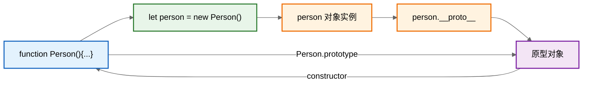
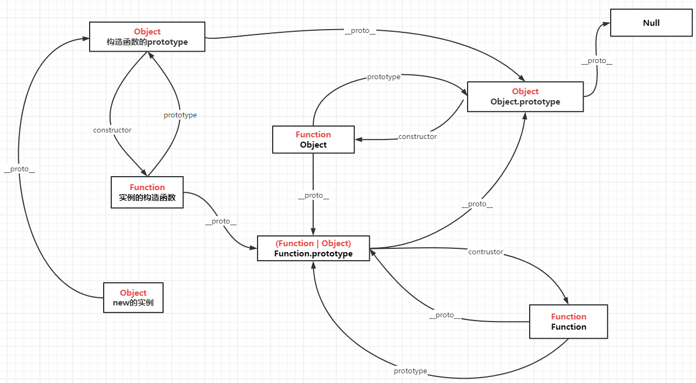
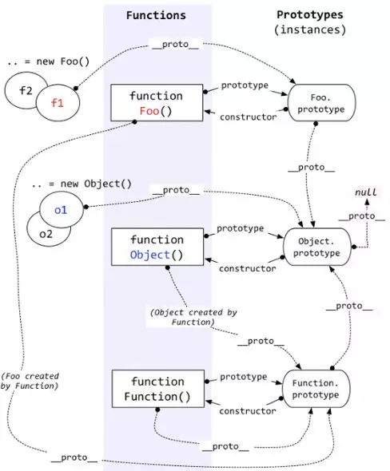

# 原型与原型链

```javascript
// 原型
function F() {}
Object.prototype.a = function () {
  console.log('a')
}
Function.prototype.b = function () {
  console.log('b')
}
const f = new F()
f.a()
f.b()
```

<span style="color: #3498db;">【补充】上面这段代码的运行结果是：`f.a()` 输出 `'a'`，而 `f.b()` 报错 `TypeError: f.b is not a function`。</span>

<span style="color: #3498db;">【补充】原因解析：`f` 是构造函数 `F` 的实例，`f.__proto__` 指向 `F.prototype`，`F.prototype.__proto__` 又指向 `Object.prototype`。因此 `f.a()` 能沿原型链找到 `Object.prototype.a`。而 `b` 方法定义在 `Function.prototype` 上——这条链是 `F.__proto__ → Function.prototype`，属于构造函数的原型链，不是实例 `f` 的原型链，所以 `f` 找不到 `b`。这张图如下：</span>



<span style="color: #3498db;">【补充】总结：`a` 在实例原型链上 → 能找到；`b` 在构造函数的原型链上 → 实例找不到。理解 “实例的 `__proto__`” 和 “构造函数的 `__proto__`” 是两条不同的链，是掌握原型链的关键。</span>

```mermaid
%%{init: { "theme": "neutral", "themeVariables": { "fontFamily": "Microsoft YaHei, sans-serif" }, "flowchart": { "curve": "basis" } }}%%
graph TD
subgraph inst["f 的原型链（实例）"]
  f["f (实例)"] -->|__proto__| Fp["F.prototype"]
  Fp -->|__proto__| Op["Object.prototype"]
  Op -->|__proto__| Null["null"]
end
subgraph ctor["F 的原型链（构造函数）"]
  F["F (构造函数)"] -->|__proto__| FuncP["Function.prototype"]
  FuncP -->|__proto__| Op2["Object.prototype"]
end

%% 样式定义
classDef level0 fill:#E3F2FD,stroke:#1565C0,stroke-width:2px;
classDef level1 fill:#E8F5E9,stroke:#2E7D32,stroke-width:2px;
classDef level2 fill:#FFF3E0,stroke:#EF6C00,stroke-width:2px;
classDef level3 fill:#F3E5F5,stroke:#7B1FA2,stroke-width:2px;

%% 样式应用
class f level0;
class Fp level1;
class Op level2;
class Null level3;
class F level0;
class FuncP level1;
class Op2 level2;
```

## 一、引用类型皆为对象

原型和原型链都是来源于对象而服务于对象的概念，所以我们要先明确一点：JavaScript 中一切引用类型都是对象，对象就是属性的集合。

`Array` 类型、`Function` 类型、`Object` 类型、`Date` 类型、`RegExp` 类型等都是引用类型。也就是说数组是对象、函数是对象、正则是对象、对象还是对象。

```javascript
let arr = []
arr instanceof Object // true

let fn = function () {}
fn instanceof Object // true

let obj = {}
obj instanceof Object // true
```

## 二、原型和原型链是什么

上面我们说到对象就是属性（`property`）的集合，有人可能要问不是还有方法吗？其实方法也是一种属性，因为它也是键值对的表现形式。

```javascript
const obj = {}
obj.sayHello = function () {
  console.log('hello')
}

obj.hasOwnProperty('sayHello') // true
```

可以看到 `obj` 上确实多了一个 `sayHello` 的属性，值为一个函数，但是问题来了，`obj` 上面并没有 `hasOwnProperty` 这个方法，为什么我们可以调用呢？这就引出了**原型**。

每一个对象从被创建开始就和另一个对象关联，从另一个对象上继承其属性，这个另一个对象就是**原型**。

当访问一个对象的属性时，先在对象的本身找，找不到就去对象的原型上找，如果还是找不到，就去对象的原型（原型也是对象，也有它自己的原型）的原型上找，如此继续，直到找到为止，或者查找到最顶层的原型对象中也没有找到，就结束查找，返回 `undefined`。

这条由对象及其原型组成的链就叫做原型链。

<span style="color: #3498db;">【补充】属性遮蔽 (Property Shadowing)：当实例自身有一个与原型同名的属性时，原型链查找会在实例本身命中，不会继续向上查找——这种现象叫属性遮蔽。示例如下：</span>

```javascript
function Person(name) {
  this.name = name
}
Person.prototype.sayHello = function () {
  console.log('hello from prototype')
}

const p = new Person('张三')
// 实例自身也定义了同名方法
p.sayHello = function () {
  console.log('hello from instance')
}

p.sayHello() // 输出：hello from instance（遮蔽了原型上的方法）
```

<span style="color: #3498db;">【补充】理解属性遮蔽有利于避免常见踩坑：比如误以为修改实例上的某个属性会影响所有实例——实际上只是给自己挂了个同名属性，其他实例依然走原型。</span>

**原型的作用**

之所以要有原型，是因为 JS 要实现面向对象，而原型就是它的实现手段之一。一个能支持面向对象的语言必须做到一点：能判定一个实例的类型。在 JS 中，通过原型就能知晓某个对象从属于哪个类型——**原型的存在避免了类型的丢失**。

落到具体能力上，原型提供了两件事：

1. **类型判定**：`instanceof` 判断的正是 “这个构造函数的 `prototype` 在不在对象的原型链上”，所以知道原型就知道实例属于哪个类型。
2. **对象之间的关联**：每个对象都有原型，指向另一个对象；访问属性时自身没有，就沿原型链向上找，直到链的末端 `null`。

总结一下：

1. 原型存在的意义就是组成原型链：引用类型皆对象，每个对象都有原型，原型也是对象，也有它自己的原型，一层一层，组成原型链。
2. 原型链存在的意义就是继承：访问对象属性时，在对象本身找不到，就在原型链上一层一层找。说白了就是一个对象可以访问其他对象的属性。
3. 继承存在的意义就是属性共享：好处有二：一是代码重用，字面意思；二是可扩展，不同对象可能继承相同的属性，也可以定义只属于自己的属性。

## 三、创建对象

JavaScript 语言提供了三种创建对象的方式：`new Object()`、对象字面量、`Object.create()`。

<span style="color: #e74c3c;">【修正】原文写作 `new object()`，构造函数名 `Object` 首字母需大写，已修正。</span>

```javascript
// new 操作符后跟函数调用
let obj = new Object()
let arr = new Array()

// 字面量表示法
let obj1 = { a: 1 }
// 等同于
let obj2 = new Object()
obj2.a = 1

let arr1 = [1, 2]
// 等同于
let arr2 = new Array()
arr2[0] = 1
arr2[1] = 2
```

<span style="color: #e74c3c;">【修正】原示例在同一代码块内对 `obj`、`arr` 各声明两次，直接运行会抛出 `SyntaxError: Identifier 'obj' has already been declared`；已将对照写法中的变量改名为 `obj1`/`obj2`、`arr1`/`arr2`，代码可直接运行。</span>

`Object.create()` 方法接收两个参数，第一个参数 `prototype` 为必需参数，代表指定的原型对象。第二个参数 `descriptors` 为可选参数，它是包含 n 个属性及其描述符的对象。

在调用 `Object.create()` 时，可以传入 `null` 来创建一个更干净的没有原型对象的对象。

构造函数用来创建对象，同一构造函数创建的对象，其原型相同。

<span style="color: #3498db;">【补充】理解 `new` 操作符的内部流程，对掌握原型链至关重要。当我们执行 `new Person('张三')` 时，JS 引擎实际做了以下几步：</span>

```javascript
// new Person('张三') 的近似实现
function myNew(constructor, ...args) {
  // 1. 创建一个空对象，将其 __proto__ 指向构造函数的 prototype
  const obj = Object.create(constructor.prototype)
  // 2. 以 obj 为 this 执行构造函数
  const result = constructor.apply(obj, args)
  // 3. 如果构造函数返回了引用类型的值，优先返回该值；否则返回 obj
  return result instanceof Object ? result : obj
}
```

<span style="color: #3498db;">【补充】核心要点：`new` 会把新对象的 `__proto__` 挂到构造函数的 `prototype` 上，这一步就是 “同一构造函数创建的对象共享同一个原型” 的根本原因。</span>

## 四、`__proto__` 与 `prototype`

先分清两个名字，这是后面所有讨论的基础：

| 名称 | 谁身上有 | 含义 |
| --- | --- | --- |
| `prototype` | 函数（箭头函数除外） | 显式原型，指向一个对象，用来存放该构造函数所有实例共享的属性和方法 |
| `__proto__` | 每个对象（`Object.create(null)` 除外） | 隐式原型，也就是原型链的 “链接点”，保存着该对象所属构造函数的 `prototype` |

```javascript
function Test() {}
console.log(Test.prototype) // {}：函数身上的显式原型

const test = new Test()
console.log(test.__proto__) // {}：实例身上的隐式原型
console.log(test.__proto__ === Test.prototype) // true
```

两者指向的是同一个对象，用图把这条关系串起来：

```mermaid
%%{init: { "theme": "neutral", "themeVariables": { "fontFamily": "Microsoft YaHei, sans-serif" }, "flowchart": { "curve": "basis" } }}%%
graph LR
A["function Person(){...}"] --> B["let person = new Person()"]
B --> C["person 对象实例"]
C --> D["person.__proto__"]
D --> E["原型对象"]

%% 样式定义
classDef level0 fill:#E3F2FD,stroke:#1565C0,stroke-width:2px;
classDef level1 fill:#E8F5E9,stroke:#2E7D32,stroke-width:2px;
classDef level2 fill:#FFF3E0,stroke:#EF6C00,stroke-width:2px;
classDef level3 fill:#F3E5F5,stroke:#7B1FA2,stroke-width:2px;
classDef decision fill:#ECEFF1,stroke:#455A64,stroke-width:2px,stroke-dasharray: 5 5;

%% 样式应用
class A level0;
class B level1;
class C level2;
class D level2;
class E level3;
```



<span style="color: #e74c3c;">【修正】原文三张 Mermaid 图的节点文案 `persor对象实例` 均为拼写错误，已统一改为 `person 对象实例`；同时修正了节点文案中 `function Person ()`、`let person =new Person()` 的括号与等号空格。</span>

`__proto__` 属性虽然在 ECMAScript 6 语言规范中标准化，但是不推荐被使用，现在更推荐使用 `Object.getPrototypeOf`，`Object.getPrototypeOf(obj)` 也可以获取到 `obj` 对象的原型。本文中使用 `__proto__` 只是为了便于理解。

```javascript
Object.getPrototypeOf(person) === person.__proto__ // true
```

上面说过，构造函数是为了创建特定类型的对象，那如果我想让 `Person` 这个构造函数创建的对象都共享一个方法，总不能像下面这样吧：

**错误示范**

```javascript
// 调用构造函数 Person 创建一个新对象 personA
let personA = new Person('张三')
// 在 personA 的原型上添加一个方法，以供之后 Person 创建的对象所共享
personA.__proto__.eat = function () {
  console.log('吃东西')
}
let personB = new Person('李四')
personB.eat() // 输出：吃东西
```

但是每次要修改一类对象的原型对象，都去创建一个新的对象实例，然后访问其原型对象并添加 or 修改属性总觉得多此一举。既然构造函数创建的对象实例的原型对象都是同一个，那么构造函数和其构造出的对象实例的原型对象之间有联系就完美了。

这个联系就是 `prototype`。每个函数拥有 `prototype` 属性，指向使用 `new` 操作符和该函数创建的对象实例的原型对象。

```javascript
Person.prototype === person.__proto__ // true
```



看到这里我们就明白了，如果想让 `Person` 创建出的对象实例共享属性，应该这样写：

```javascript
Person.prototype.drink = function () {
  console.log('喝东西')
}

let personA = new Person('张三')
let personB = new Person('李四')
personB.drink() // 输出：喝东西
```

<span style="color: #e74c3c;">【修正】原示例只声明了 `personA` 就直接调用 `personB.drink()`，会抛 `ReferenceError`；已在调用前补上 `let personB = new Person('李四')`。</span>

**总结一下**：

1. 对象有 `__proto__` 属性，函数有 `__proto__` 属性，数组也有 `__proto__` 属性，只要是引用类型，就有 `__proto__` 属性，指向其原型。
2. 只有函数有 `prototype` 属性，指向 `new` 操作符加调用该函数创建的对象实例的原型对象，让构造函数实例化的所有对象可以找到公共的方法和属性。

## 五、原型链顶层

原型链之所以叫原型链，而不叫原型环，说明它是有始有终的，那么原型链的顶层是什么呢？

拿我们的 `person` 对象来看，它的原型对象，很简单：

```javascript
// 1. person 的原型对象
person.__proto__ === Person.prototype
// 2. Person.prototype 的原型对象
Person.prototype.__proto__ === Object.prototype
Object.prototype.__proto__ === null
```

我们就可以换个方式描述下原型链：由对象的 `__proto__` 属性串连起来的直到 `Object.prototype.__proto__`（为 `null`）的链就是原型链。

```javascript
// 模拟 JS 引擎读取对象属性
function getProperty(obj, propName) {
  // 在对象本身查找
  if (obj.hasOwnProperty(propName)) {
    return obj[propName]
  } else if (obj.__proto__ !== null) {
    // 如果对象有原型，则在原型上递归查找
    return getProperty(obj.__proto__, propName)
  } else {
    // 直到找到 Object.prototype，Object.prototype.__proto__ 为 null，返回 undefined
    return undefined
  }
}
```

## 六、constructor

回忆一下之前的描述，构造函数都有一个 `prototype` 属性，指向使用这个构造函数创建的对象实例的原型对象。

这个原型对象中默认有一个 `constructor` 属性，指回该构造函数。

```javascript
Person.prototype.constructor === Person // true
```



还有一处高频坑：给原型**加属性**和给构造函数**换原型**是两件事。

```javascript
function Foo() {}
const f = new Foo()

console.log(f.a) // undefined：此时 Foo.prototype 上还没有 a
Foo.prototype.a = 1 // 在原来的原型对象上新增属性
console.log(f.a) // 1：f.__proto__ 一直指向这个原型对象

Foo.prototype = { a: 2 } // 这里是把 Foo.prototype 换成了一个新对象
console.log(f.a) // 1：f.__proto__ 仍然指向旧的原型对象
const f2 = new Foo()
console.log(f2.a) // 2：只有之后新建的 f2 用上了新原型
```

原因很简单：实例的 `__proto__` 在 `new` 的那一刻就绑定好了，之后再替换构造函数的 `prototype`，只会影响此后新建的实例。

换原型还有一个副作用——默认的 `constructor` 会一起丢掉。因为新原型是一个普通字面量对象，它的 `constructor` 继承自 `Object.prototype`：

```javascript
function Foo() {}
Foo.prototype = { a: 2 }
Foo.prototype.constructor === Foo // false
Foo.prototype.constructor === Object // true
```

所以重写原型时，通常会手动把 `constructor` 补回来：

```javascript
function Foo2() {}
Foo2.prototype = {
  constructor: Foo2, // 手动补回，保证 constructor 指回构造函数
  a: 2
}
```

## 七、函数对象的原型链

```javascript
let fn = function () {}
// 函数（包括原生构造函数）的原型对象为 Function.prototype
fn.__proto__ === Function.prototype // true
Array.__proto__ === Function.prototype // true
Object.__proto__ === Function.prototype // true

// 自己写的构造函数同样是函数，同理
function Test() {}
Test.__proto__ === Function.prototype // true

// Function 自己也是函数，所以它的 __proto__ 指向自己的 prototype
Function.__proto__ === Function.prototype // true
Object.__proto__ === Function.__proto__ // true：等价写法
```

`Function.prototype` 也是一个普通对象，所以 `Function.prototype.__proto__ === Object.prototype`。

这里有一个特例，`Function` 的 `__proto__` 属性指向 `Function.prototype`。

总结一下：函数都是由 `Function` 原生构造函数创建的，所以函数的 `__proto__` 属性指向 `Function` 的 `prototype` 属性。

<span style="color: #3498db;">【补充】`Function` 本身也是函数，而它正是由 `Function` 自己创建的，所以 `Function.__proto__ === Function.prototype` 成立：这是所有内置对象里唯一一处 “自指”，也就是所谓 “特例” 的来源。</span>

## 八、`instanceof` 与原型继承

`instanceof` 判断的是原型链，而不是 “这个对象是谁 `new` 出来的”。

```javascript
function A() {}
function B() {}
const a = new A()
A.prototype = new B()
console.log(a instanceof B) // false

const a2 = new A()
console.log(a2 instanceof B) // true
console.log(A.prototype.constructor === B) // true：constructor 跟着 new B() 一起被换了
```

`a` 是在替换原型之前创建的，它的 `__proto__` 指向旧的 `A.prototype`，这条链上没有 `B.prototype`，所以结果是 `false`；`a2` 是在替换之后创建的，它的 `__proto__` 就是 `new B()` 得到的那个对象，而那个对象的 `__proto__` 正是 `B.prototype`，所以结果是 `true`。

这条结论的实践含义是：用构造函数改写原型来实现继承时，顺序不能颠倒——先设置 `A.prototype = Object.create(B.prototype)`，再 `new A()`。直接写 `A.prototype = new B()` 虽然也能跑通，但有两个副作用：

1. `new B()` 的构造过程会被执行一次，`B` 的实例属性因此变成了所有 `A` 实例共享的属性。
2. `A.prototype` 的 `constructor` 会指向 `B`，不再是 `A`。

所以更推荐 `Object.create(B.prototype)`：它只借用原型链，不执行 `B` 的构造函数，也就不会把 `B` 的实例属性挂到 `A` 的原型上。

## 九、原型图




---

<span style="color: #3498db;">【补充】全文总结：</span>

1. 每个对象的 `__proto__` 都指向创建它的那个原型对象，通常是其构造函数的 `prototype`。<span style="color: #e74c3c;">【修正】原写作 “每个对象都有 `__proto__`，指向其构造函数的 `prototype`”，该说法对 `Object.create(null)` 创建的无原型对象、以及用 `Object.create(obj)` 指定原型的对象并不成立，已改为更准确的表述。</span>
2. 只有函数有 `prototype` 属性，用于定义其创建的所有实例共享的属性和方法。
3. 实例、构造函数的 `prototype`、`Object.prototype`、`null` 串成原型链，属性查找沿链向上。
4. 构造函数的 `__proto__` 链（通向 `Function.prototype`）和实例的 `__proto__` 链（通向 `Object.prototype`）是两条不同的链，要分清楚。
5. 属性遮蔽、`new` 的内部流程、`constructor` 回指等细节，都是面试和实际开发中的高频考点。
6. 实例的 `__proto__` 在 `new` 那一刻就已绑定，替换构造函数的 `prototype` 只影响之后新建的实例；整体替换还会丢掉 `constructor`，需要手动补回。
7. `instanceof` 沿原型链查找 `prototype`，所以原型替换的时机直接决定判断结果；实现继承优先用 `Object.create(B.prototype)`，而不是 `new B()`。

<span style="color: #3498db;">【补充】掌握了上述内容，再回头看开篇那段 `f.a()` 能成功、`f.b()` 却报错的代码，应该就能画出完整的原型链图谱了。</span>
